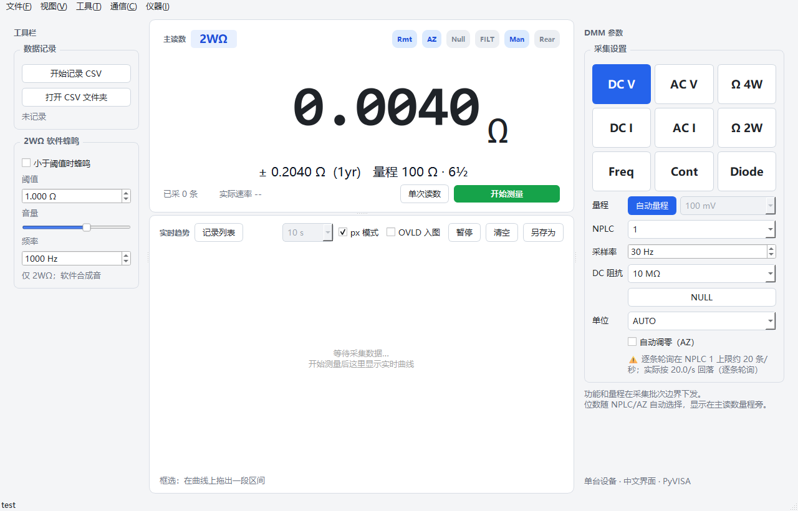
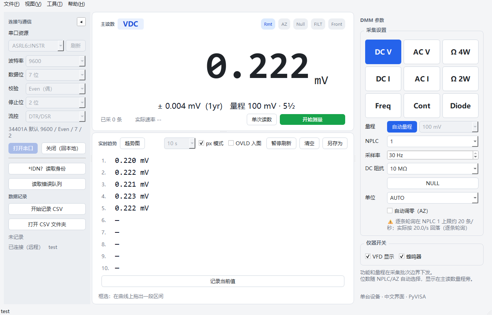

# Hewlett Packard 34401A 上位机

Windows 桌面程序，用于 HP / Agilent / Keysight 34401A 台式万用表的串口通信、连续采集、趋势显示和 CSV 记录。

技术栈：Python 3.14、PySide6（Qt Widgets）、PyVISA、pyserial。

## 功能

- 串口打开/关闭、`*IDN?` 握手、单次读数
- DCV / ACV / DCI / ACI / 2WΩ / 4WΩ / 频率 / 周期 / 导通 / 二极管
- 连续采集、可调最高采样率、NPLC、自动/手动量程、AZ、Null
- 实时读数、趋势图、记录列表
- CSV 连续记录与缓冲区导出
- 软件日志、串口原始字节日志
- 34401A 错误码查询
- 平均值功能：每 N 次读数取平均后输出
- 可置顶悬浮窗：读数、状态、右键六项功能轮盘
- 曲线粗细、时间窗 PX / 5 s / 10 s / 30 s / 1 min / ALL TIME / 自定义

## 34401A 串口设置

| 参数 | 值 |
|---|---|
| 波特率 | 9600 |
| 数据位 | 7 |
| 校验 | Even |
| 停止位 | 2 |
| 流控 | DTR/DSR |
| 线缆 | null-modem |

程序也接受 `COM10`、`ASRL10`、`ASRL10::INSTR` 形式的串口资源。

## 界面

- 主读数：大字号数值、单位、精度误差、量程、实际速率
- 趋势图：全时间范围、像素包络绘制、悬停读数、框选统计
- 记录列表：序号、时间、读数、备注、参数
- 左栏：CSV 记录、平均值、悬浮窗、2WΩ 蜂鸣





## 平均值

- 默认关闭，N 默认 10，可设 1–1000。
- 每 N 次原始读数取平均后输出 1 条。
- 单次读数同样会平均 N 次。
- 输出速率约为输入速率除以 N。
- 可选增加 `floor(log10 N / 2)` 位显示小数。
- 记录参数末尾会追加 `×NAVG`。

## 悬浮窗

- 默认 500 × 120 px，尺寸 50–200%，不透明度 20–100%。
- 尺寸和不透明度会保存。
- 始终置顶，左键拖动，可选开启时最小化主窗口。
- 显示主读数和单位，固定 7 位数字格式。
- 导通开路显示 `OPEN`，其他超量程显示 `OVLD`，无数据显示 `-`。
- 左下显示 READ 指示 `*` 及 Man/Math/Rear/Diode/Cont 状态。
- 右键呼出 200 px 六项功能轮盘：DCV、CONT、Ω2W、DCI、NPLC、BACK。

## CSV

默认写入用户文档目录下的 `34401A数据` 文件夹，可在“文件 → 更改 CSV 存储位置”修改。

文件名：

```text
VDC_mmdd_hhmm.csv
```

采用 UTF-8 BOM，Excel 可直接打开。

## 说明

- 所有代码都由AI编写，未经过完全验证
- 程序不会修改注册表、环境变量或 Windows 电源设置。
- 串口、功能和界面配置保存在用户配置目录。
- GPIB 和多设备支持尚未实现。
